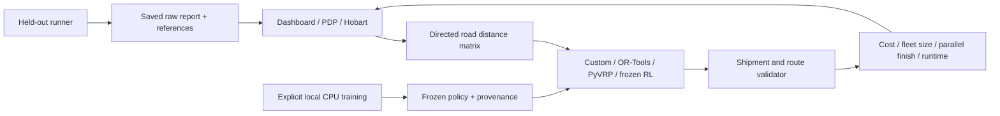

# Route Lab — routing, fleet objectives and a learned policy

A React + FastAPI portfolio experiment comparing custom pathfinding, pickup-and-delivery heuristics, OR-Tools, PyVRP and a locally trained reinforcement-learning insertion policy. The dashboard uses one frozen request and distance matrix per comparison, checks shipment feasibility independently, and keeps failed results out of the ranking.

## Run locally

Python 3.11+ and Node.js 22+ are recommended. On macOS/Linux, run `./run-local.command`, then open [the dashboard](http://127.0.0.1:5173/dashboard). The launcher prepares a missing local environment and stops its servers on Ctrl+C. The synthetic dashboard, training and saved reports run on localhost without hosted AI or API keys. Hobart map views request external OpenStreetMap tiles; a missing graph cache triggers an external graph download. The bundled model is already trained—opening the dashboard does not train it.

Manual setup, in separate terminals:

```sh
python3 -m venv .venv
.venv/bin/python -m pip install -r backend/requirements.txt
.venv/bin/python -m uvicorn backend.main:app --host 127.0.0.1 --port 8000
```

```sh
cd frontend
pnpm install --frozen-lockfile
pnpm dev --host 127.0.0.1 --port 5173
```

The supplied `frontend/pnpm-lock.yaml` and `artifacts/learned/environment.txt` record the tested environment. The original npm lockfile remains for the existing npm workflow; use one package manager consistently. Windows users can activate a normal venv and run the same Python modules without the `.command` launcher.

## What the dashboard compares

- Named clustered, dispersed and balanced synthetic workloads, plus editable drivers, capacities, pickups and dropoffs.
- **Save:** minimize `active drivers × activation cost + kilometres × cost per km`. Fleet size is chosen by the method, rather than forcing every driver to work. Rates are configurable demonstration currency units, not measured business costs.
- **Time:** every supplied driver serves at least one whole order; minimize the latest driver's finish time. Routes start together. Driver duration is `kilometres / speed × 60 + service minutes × stops`. More total travel can buy a shorter parallel completion time. All-driver usage can be impossible; the app reports that condition rather than presenting empty routes as active work.
- Four delivery methods, canonical cost/distance/completion, active drivers, actual runtime, status and validation errors; per-driver stop schematics and parallel completion timelines; immutable request and result JSON/CSV export.
- Original scan Dijkstra, custom-heap Dijkstra and A* on a shared path query, with an independent distance reference, measured call times and separately collected search-work counts.
- Local RL provenance, validation learning curves and a persisted held-out report, loaded from real experiment files. Interactive runs are not automatically added to held-out evidence.

Existing pages remain available: `/route-planner`, `/pdp`, `/real-map` and `/real-map-pdp`. Toy and Hobart PDP pages accept the same Save/Time objective settings and the learned method. Map segment selection is separate from delivery assignment: changing Dijkstra to A* does not independently change the delivery cost matrix.

## Methods and limitations

The custom method uses objective-aware feasible insertion plus monotonic pair relocation. A prior duplicate-assignment bug is retained as a regression fixture. OR-Tools has explicit economic costs or a duration-span objective, shipment pairing, rank precedence and capacity constraints. PyVRP has a native economic objective in Save and a transparently labeled distance-seed/refinement hybrid in Time; adapters disclose fallback construction when native search supplies no suitable incumbent. These are bounded searches, not promises of globally optimal results.

The learned method is **a small linear RL policy**, with 14 features and separate Save/Time coefficient vectors (28 scalar coefficients). It samples feasible driver/insertion actions during training using episodic REINFORCE, a train-only running reward baseline and Adam updates. Frozen inference uses deterministic argmax, with no hidden local-search refinement. Feasibility masks, order sequencing and feature definitions are hand engineered; this is not an attention network, a pretrained model or a traffic predictor. It may lose to classical solvers, and the report must show those losses.

Training uses 500 synthetic episodes per mode. Train, validation and test instance seeds are disjoint, but all use the same small 20-node topology. This does not demonstrate generalization to unseen cities. Validation selects a checkpoint; test outcomes are not used for model tuning. Training cost is separate from inference time. [Research on learned routing](https://arxiv.org/abs/1803.08475) motivates policy-gradient approaches; this implementation is a deliberately smaller experiment, not a reproduction of that paper's attention model or results.

Time figures use constant-speed and per-stop service assumptions. There is no live traffic, measured ETA accuracy, time-window scheduling, driver shifts, breaks or turn-restriction state. Routes are open (no return to a depot). Synthetic graph units default to 1 km per unit as an explicit demo assumption. Hobart graph lengths are metres; map views draw node polylines rather than full curved road-edge geometry. The cached graph is a bounded snapshot, not current navigation-grade coverage. The dashboard's stop schematics intentionally do not trace intermediate road edges.

## Reproduce and inspect experiments

```sh
# Only explicit training changes the frozen model artifact.
.venv/bin/python -m backend.ml.train
# Refuses to overwrite an existing held-out report: preserve inspected evidence.
.venv/bin/python -m backend.ml.evaluate
# Affected application and independent acceptance checks.
.venv/bin/python -m pytest backend/tests -q
# Production frontend build.
cd frontend && pnpm build
```

Training writes `artifacts/learned/policy.json`, its SHA-256 sidecar, learning curve and split manifest. The report contains raw cases, statuses, canonical metrics, timings, exact references on tiny instances, best-known feasible references elsewhere, zero-weight policy ablation and a small five-seed PyVRP variability subset. Compare paired cases and feasible rates before averages; workloads and rates differ between cases. A best-known gap is not an optimality gap. Do not retrain from inspected test outcomes and reuse those seeds as a fresh test.

See [backend contracts](docs/backend-benchmarks.md), [independent acceptance evidence](docs/ACCEPTANCE-TESTS.md) and [experiment findings](docs/EXPERIMENT.md) for actual checks and measured limitations. No coverage percentage is claimed from a test count.

## API and architecture

`GET /api/benchmarks/model`, `GET /api/benchmarks/report`, `GET /api/benchmarks/paths` and `POST /api/benchmarks/compare`. Interactive delivery comparison is bounded to 20 orders, 8 drivers and 1–10 seconds per selected method. The cached Hobart adapter remains on the existing map endpoints. [Interactive API documentation](http://127.0.0.1:8000/docs) is available while running.



This is an educational and portfolio prototype with reproducible limitations, not a production dispatch or navigation service.
